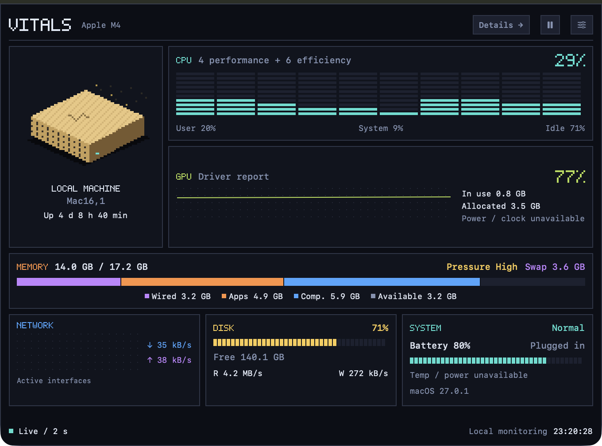

[English](README.md) · **简体中文**

# Vitals —— 菜单栏系统监视器

Vitals 是一个只存在于菜单栏中的 macOS 系统监视器。菜单栏图标显示实时的 CPU 迷你曲线和占用百分比；点击它会打开一个深色像素仪表盘，其中包含 CPU、内存、网络、磁盘、电池和进程详情。没有 Dock 图标，也没有主窗口。

<p align="center">
  
</p>

要求 macOS 26.0 及以上。使用 Xcode 27 / macOS 27 SDK 开发。

## 功能

- 应用图标使用像素风格的 V 形脉冲，菜单栏则保留清晰的单色 V 标记；菜单栏图标是单色矢量，会自适应浅色与深色外观
- 四种菜单栏显示模式：曲线、数字、曲线 + 数字、图标；曲线颜色跟随负载变化（绿 / 橙 / 红），采样暂停时会叠加一个暂停符号
- CPU：总占用率、每核柱状图和最近 120 次采样的点阵历史；总览显示分段的每核柱条以及性能核 / 能效核数量；DETAILS 入口提供历史、负载均值和逐核明细
- GPU：总览显示驱动上报的占用率、历史和已用 / 已分配显存；详情页增加渲染器与分块器占用率，缺失字段显示为 N/A
- 内存：已用 / 总量、wired-apps-compressed-available 分段条、系统内存压力和交换区；展开可查看文件缓存、空闲页和交换区总量
- 网络：上传与下载速率及历史，用像素曲线区分上传与下载，详情页提供峰值统计
- 磁盘：启动卷容量条；详情页列出每个可读块设备（包括磁盘映像）的读 / 写速率、操作次数和历史，读 / 写采样可在设置中关闭
- 系统：1 / 5 / 15 分钟负载均值、逻辑核心数、热状态、运行时长和低电量模式
- 电池：SYSTEM 区域显示电量，悬停显示充电状态和预计剩余时间（IOPowerSources）；低电量模式有标记
- 进程：详情页列出按 CPU 排序的前 5 个进程及其占用率和常驻内存（sysctl + libproc 差值采样）
- 热状态：SYSTEM 区域报告 NORMAL / WARM / HOT / CRITICAL
- 提醒：针对持续高 CPU（默认连续 30 秒达到或超过 90%）、磁盘使用率和热状态升级发送系统通知，每个提醒有 5 分钟冷却
- 语言：跟随系统、简体中文或英文，总览、详情、设置、提示和通知一同切换；必要的产品名、进程名和技术缩写保持原样
- 设置窗口：菜单栏模式、采样间隔（0.5 / 1 / 2 秒）、CPU / GPU / 内存 / 网络 / 磁盘 / 传感器 / 电池 / 进程开关、提醒阈值，以及登录时启动

## 使用的系统特性

| 类别 | API |
| --- | --- |
| 视觉 | Canvas 像素字形、等距主机插画、分段条、点阵曲线、直角描边与固定深色调色板 |
| 视觉 | 总览、详情和设置共用同一套 PixelSection / PixelSegments / PixelTrace / 像素开关与选项按钮 |
| 视觉 | Canvas 点阵折线与分段式每核柱条，操作图标使用 SF Symbols |
| 逻辑 | `@Observable`（Observation 框架）驱动全部 UI；Swift 6 语言模式与严格并发 |
| 逻辑 | `MenuBarExtra(.window)` 配合自定义标签和 popover 内容；`openSettings` 加设置窗口激活 |
| 逻辑 | 采样：mach `host_processor_info` / `host_statistics64`、`getifaddrs`、`sysctl`（vm.swapusage、KERN_PROC_ALL）、`proc_pid_rusage`、`getloadavg`、IOKit 块设备统计、IOPowerSources、`ProcessInfo.thermalState` |
| 逻辑 | `SMAppService` 登录项、AppIntents（"暂停或恢复 Vitals 监视"快捷指令）、UserNotifications 提醒 |
| 逻辑 | 结构化并发采样循环（`Task` + `Task.sleep`）、Swift Testing 单元测试 |

## 构建与安装

```bash
xcodegen generate
xcodebuild -project Vitals.xcodeproj -scheme Vitals -configuration Release \
  -destination 'platform=macOS,arch=arm64' -derivedDataPath .build/DerivedData build
cp -R .build/DerivedData/Build/Products/Release/Vitals.app /Applications/
open /Applications/Vitals.app
```

测试：

```bash
xcodebuild test -project Vitals.xcodeproj -scheme Vitals -destination 'platform=macOS,arch=arm64' \
  -derivedDataPath .build/DerivedData
```

应用图标由 `Tools/make_icon.swift` 生成（用 CoreGraphics 绘制，写入 asset catalog，再用 sips 缩放到完整尺寸集）：

```bash
swift Tools/make_icon.swift Sources/Vitals/Assets.xcassets/AppIcon.appiconset/icon_512x512@2x.png
```

## 架构

```
Sources/Vitals/
  VitalsApp.swift            App 入口：MenuBarExtra(.window) + Settings 场景
  Core/
    SensorHub.swift          @MainActor @Observable 状态机；采样循环与提醒调度
    Samplers.swift           mach / getifaddrs / sysctl / IOKit 底层采样
    ProcessSampler.swift     sysctl(KERN_PROC_ALL) + proc_pid_rusage 进程采样
    GPUSampler.swift         IOAccelerator 驱动统计与缺失值校验
    BatteryKit.swift         IOPowerSources 电池读取
    AlertEngine.swift        纯逻辑提醒引擎（阈值 + 时长 + 冷却）
    Models.swift             CPUTicks / CPUMath / DiskMath 等模型与纯函数
    LaunchAtLogin.swift      SMAppService 封装
    Localization.swift       语言选择、资源查找与格式化
    Units.swift, Ring.swift
  UI/
    PopoverView.swift        Popover 入口
    PixelDashboardView.swift 像素仪表盘，总览 / 详情导航
    PixelArt.swift           手绘像素字形与等距主机插画
    PixelDetailsView.swift   同样像素风格的完整详情
    PixelControls.swift      设置与详情共用的像素控件
    LocalizedContent.swift   跨窗口的语言与区域环境
    MenuBarLabelView.swift   菜单栏标签（四种模式）
    SparklineRenderer.swift  CoreGraphics 迷你曲线与 V 形矢量标记
    SettingsView.swift       像素风格设置页
    SettingsPresenter.swift  设置窗口激活、首次显示与把已有窗口提到最前
    Theme.swift
  Intents/
    ToggleMonitoringIntent.swift
```

采样节奏：CPU / GPU / 内存 / 网络 / 系统负载 / 磁盘 I/O 每个采样间隔刷新一次；电池每 5 个周期刷新一次，磁盘容量每 30 个周期刷新一次，进程每 5 秒刷新一次，以压低常驻开销。

## 已知限制

- 进程名来自 `kinfo_proc.kp_proc.p_comm`，上限 16 个字符；更长的名字会被截断
- 进程 CPU 占用依赖 `proc_pid_rusage`，对其他用户拥有的进程可能返回不到数据，因此这类进程会被跳过
- GPU 数据依赖驱动提供的 IOKit PerformanceStatistics —— 这不是稳定的跨机器接口；不可用的字段显示为 N/A，绝不显示为 0
- GPU 的已用 / 已分配显存是驱动计数器，可能与系统内存分类重叠；二者不能相加，也不能用来推算专用 VRAM
- 温度、风扇转速、时钟频率和功耗没有可靠来源，显示为 N/A；热状态不会换算成摄氏度
- 内存占用是根据内核页计数得出的估算值，不保证与活动监视器完全一致；读取失败的内存压力显示"不可用"
- 磁盘吞吐是所有可读设备（包括磁盘映像）的合计，不代表单一启动卷；在新挂载、计数器重置和采样恢复时会建立基线，以避免虚假尖峰
- 像素主机是装饰性插画，并不描绘当前 Mac 的机箱；它的指示像素跟随真实 CPU 占用
- 像素总览与详情不使用持续动画，只随真实采样更新

## 视觉检查

Debug 构建接受 `--debug-panel`，可在普通窗口中显示 popover 内容；加上 `--debug-dark` 可检查深色外观。这些入口不属于 Release 构建。

Popover 为 680 × 500，使用固定的深色像素仪表盘。顶部是主机插画、每核柱条和 GPU 历史；中部是内存分段条；底部是网络、磁盘和系统。进程排行位于详情页。DETAILS 打开可滚动的详情页，MONITOR 返回总览；暂停和设置始终可达。

风格参考：[像素系统监视面板](https://hub.v2core.com/p/c7e22d4d210af8835c20a4de7734dd7c139ddac335c3689e030e1de4eb6b84c8)。所有图形都用原生 SwiftUI / Canvas 绘制；文案来自 `Resources/en.lproj` 和 `Resources/zh-Hans.lproj`。较短的英文标题使用像素字形，中文或缺少字形的文本则回退到清晰的系统字体。GPU 数字是本机驱动上报的真实读数；参考图中的功耗、频率和温度数字既未被照搬，也未被模拟。


## 数据语义

- `vm.swapusage` 通过 `xsw_usage` 二进制结构读取，字段单位为字节。
- 进程 CPU 时间先用 `mach_timebase_info` 换算成纳秒，再通过时间差换算；一个逻辑核满负荷为 100%，多线程进程可以超过 100%。换算方式见 [Apple XNU task.c](https://github.com/apple-oss-distributions/xnu/blob/main/osfmk/kern/task.c)。
- 内存压力的 sysctl 返回的是 dispatch 标志（1 / 2 / 4），与内核内部的枚举不同。见 [Apple XNU kern_memorystatus_notify.c](https://github.com/apple-oss-distributions/xnu/blob/main/bsd/kern/kern_memorystatus_notify.c)。
- 磁盘吞吐基于各设备累计计数器的差值，先按稳定设备 ID 匹配再求和。[Apple 对 bytes-read 计数器的说明](https://developer.apple.com/documentation/iokit/kioblockstoragedriverstatisticsbytesreadkey)。

模块开关同时控制总览和详情。关闭 GPU / 磁盘 I/O 也会停止对应的采样；CPU / 内存会继续供给菜单栏和提醒。有多个 GPU 时，总览显示最忙的那块设备，切换设备会重建 GPU 历史，而详情会列出所有设备。性能核 / 能效核数量只显示系统报告的总数，不推断逐核编号。

## 许可证

Vitals 以 [MIT License](LICENSE) 发布。

## 本地打包

运行 `bash scripts/package-app.sh` 可生成 Xcode 工程、构建 Apple 芯片版本，并把本地签名的副本放到 `dist/Vitals.app`。替换已安装的副本前请先退出 Vitals。

本地构建使用 ad-hoc 签名，且未公证。GitHub Actions 在 macOS 26 上运行测试并打包本地构建；它不会发布 release。
